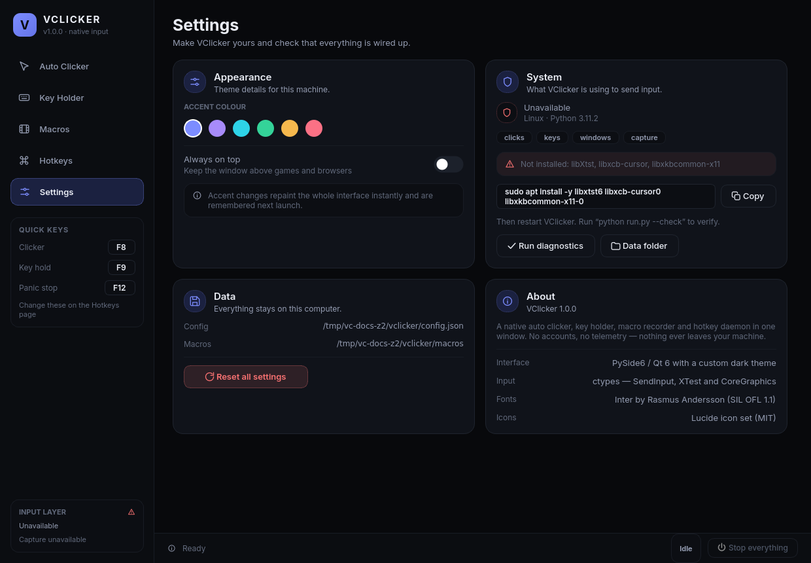
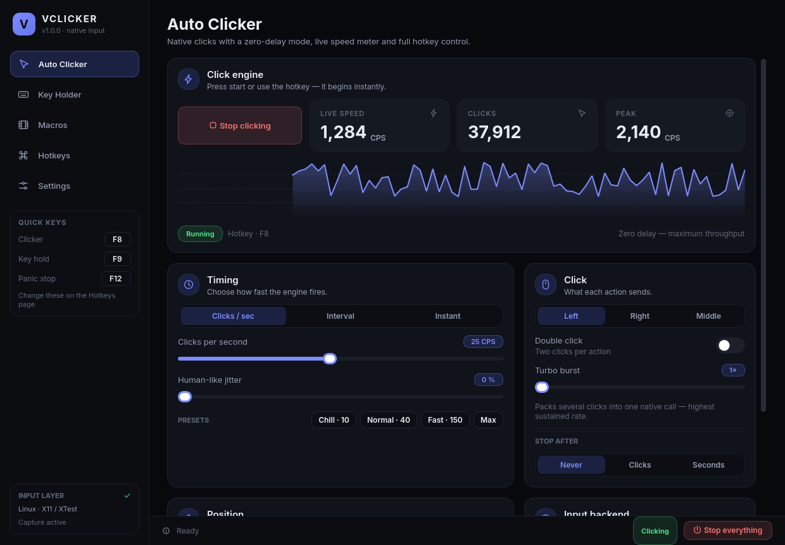
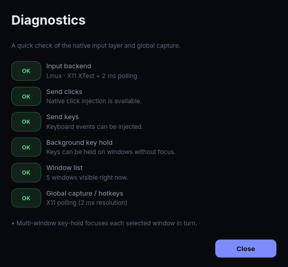
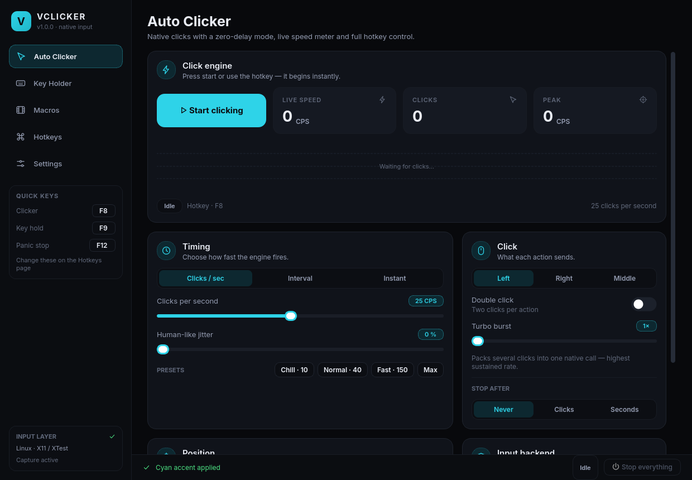

# VClicker

**An auto clicker with an "instant" mode, a multi-window key holder, global hotkeys and a macro recorder — in one native desktop app.**

VClicker talks straight to the operating system (`XTest` on Linux, `SendInput` on Windows, `CoreGraphics` on macOS) through Python's `ctypes`, so there is no interpreter overhead between your click and the system. The only dependency is Qt 6 for the interface.


---

## Linux — quick start

### Easiest: the installer

```bash
git clone https://github.com/fak3hidden/vclicker.git
cd vclicker
./install-linux.sh
```

The script installs the two system libraries VClicker needs (`libXtst` for input injection, plus the Qt 6 xcb plugin libraries), creates a private `.venv`, and adds a **VClicker** entry to your applications menu. It detects apt / pacman / dnf / zypper / apk automatically.

Afterwards launch it from the menu, or:

```bash
vclicker            # ~/.local/bin/vclicker
```

Flags: `--skip-system` (only do the Python part), `--uninstall` (remove the launcher, icons and venv).

### Manual install

```bash
# Debian / Ubuntu / Mint / Pop!_OS
sudo apt install libxtst6 libxcb-cursor0 libxkbcommon-x11-0

# Arch / Manjaro / SteamOS
sudo pacman -S libxtst xcb-util-cursor libxkbcommon

# Fedora
sudo dnf install libXtst xcb-util-cursor libxkbcommon-x11

# openSUSE
sudo zypper install libXtst6 libxcb-cursor0 libxkbcommon-x11-0

# then
python3 -m venv .venv && . .venv/bin/activate
pip install -r requirements.txt
python run.py
```

### Not working? Run the checker

```bash
python run.py --check
```

```
VClicker environment check
==============================================
Python          3.12.3  (/usr/bin/python3)
PySide6         6.12.0
System          Ubuntu 24.04.1 LTS
Session         X11 (:0)
Qt platform     xcb

X display       reachable  (:0)

Native libraries
  libX11.so.6              ok                   X11 client library
  libXtst.so.6             ok                   XTest input injection
  ...

Input backend   Linux · X11 XTest + 2 ms polling
Capabilities    clicks=yes  keys=yes  multi-window hold=yes  window list=yes  recording=yes  hotkeys=yes
```

If something is missing the app tells you what to install and gives you a **Copy** button — no guessing:



### X11 vs Wayland

| | X11 (Xorg) session | Wayland session |
|---|---|---|
| Clicks & keys in native apps | yes | **no** — Wayland blocks synthetic input by design |
| Clicks & keys in XWayland apps (most games via Proton/Wine) | yes | yes |
| Window list & multi-window key hold | yes | XWayland windows only |
| Global hotkeys while another app is focused | yes | XWayland windows only |

Wayland has no XTest equivalent without root-level device access, so if you want the full feature set (especially games), **log out and pick "X11" / "Xorg" on the login screen** (click the gear icon next to *Sign in*). Many games are X11-only for this reason anyway.

VClicker still runs fine on Wayland and warns you in-app; it just can't reach native Wayland windows.

---

## The four tools



### Auto clicker

| Mode | What it does |
|---|---|
| **Clicks / sec** | Fires at a fixed rate (1 – 1000 CPS), drift-free scheduling. |
| **Interval** | Fires every *N* milliseconds. |
| **Instant** | Zero delay: a tight native loop. Expect tens of thousands of clicks per second and one busy CPU core. |

* **Turbo burst** packs 1–64 clicks into a single native input call — the highest sustained rate the system accepts.
* **Stop after** is unlimited, a click count, or a duration.
* **Position** follows the cursor, or locks to a point you pick with a 3-second countdown.
* **Human-like jitter** randomises the delay.
* Presets: *Chill · 10*, *Normal · 40*, *Fast · 150*, *Max* (instant).

### Key holder


1. Pick the key (up to four keys).
2. **Until released** or **Timed** (auto-release after *N* seconds).
3. **Active window**, or **Selected windows** — tick as many open windows as you like.
4. Press *Hold keys* (`F9`).


On X11 the selected windows are focused in turn when the hold starts (X11 has no safe background key delivery); the previous focus is restored immediately. DirectInput/Raw Input games ignore synthetic input — use *Active window* for those.

### Macros


Press **Record** (or `F10`), do your thing, press it again — the macro lands in your library automatically. Playback supports speed (0.25× – 4×), loops and **turbo** (ignore original delays). Import/export is plain JSON:

```json
{
  "format": "vclicker.macro",
  "version": 1,
  "name": "Boss rotation",
  "created": "2026-11-22T16:26:55",
  "duration": 4.2,
  "events": [
    {"t": 0.0,  "e": "move", "x": 812, "y": 430},
    {"t": 0.02, "e": "down", "b": "left", "x": 812, "y": 430},
    {"t": 0.06, "e": "up",   "b": "left"},
    {"t": 0.4,  "e": "key_down", "k": "1"},
    {"t": 0.45, "e": "key_up",   "k": "1"}
  ]
}
```

### Hotkeys


| Action | Default |
|---|---|
| Start / stop auto clicker | `F8` |
| Hold / release keys | `F9` |
| Start / stop recording | `F10` |
| Play selected macro | `F11` |
| Emergency stop | `F12` |

Click a binding and press the combo you want — it applies immediately and is saved. The panic key works even when hotkeys are disabled. `Esc` inside the VClicker window also stops everything.

---

## Screenshots

| Settings | Diagnostics |
|---|---|
|  |  |

Six accent colours re-theme the whole interface instantly:



---

## Windows & macOS

**Windows**

```bat
pip install PySide6-Essentials
python run.py
```
or double-click **`run.pyw`** (no console). Build a single `VClicker.exe` with `pip install pyinstaller && python tools/build_exe.py`.

Clicks use `SendInput`; capture uses low-level hooks; multi-window key hold uses `PostMessage` so target windows stay in the background. **Run as administrator** if the game runs elevated, or Windows will block the input.

**macOS** — `python3 run.py`, then grant **Accessibility** permission (System Settings → Privacy & Security → Accessibility). Support is experimental and has no multi-window targeting.

---

## Data & settings

Plain JSON, stored locally:

| OS | Location |
|---|---|
| Linux | `~/.config/vclicker/` |
| Windows | `%APPDATA%\VClicker\` |
| macOS | `~/Library/Application Support/VClicker/` |

`config.json` holds settings and hotkeys, `macros/` holds one file per macro. No telemetry, no accounts, nothing leaves your machine.

---

## Notes, limits and honesty

* **Some games ignore synthetic input.** Anything using Raw Input / DirectInput (many competitive shooters) or kernel anti-cheat won't see these clicks — that's an OS boundary. Never use automation where it's forbidden; you can lose your account.
* **Linux needs an X11 session** for full functionality (see the table above). Wayland only reaches XWayland windows.
* Global capture on X11 polls the X server every 2 ms, so macro timestamps are accurate to about 2 ms. The mouse wheel is not captured while recording on X11 (playback and manual scrolling work).
* Heavy clicking can freeze or crash the app you're clicking on — start slow, keep `F12` within reach.
* Held keys are force-released if VClicker exits.

---

## Development

```bash
python run.py --check       # environment + input layer report (no GUI)
python tools/selftest.py    # 28 engine checks: clicker timing, key holder, recorder,
                            # playback, macro storage, hotkey matching
python tools/uitest.py      # 20 UI checks driving the real window against a fake backend
python tools/x11_mock_test.py  # 28 X11 backend checks (button numbers, focus handling,
                               # property parsing, polling monitor) via fake libX11/libXtst
python tools/preview.py out/   # renders every page to PNG (offscreen)
```

Add `QT_QPA_PLATFORM=offscreen` when running the GUI tools without a display.

### How it is put together

```
run.py / run.pyw            launcher (+ --check mode)
install-linux.sh            Linux installer: system libs, venv, menu entry
packaging/                  generated app icons for the .desktop file
vclicker/
  app.py                    QApplication bootstrap, font loading, theme
  doctor.py                 environment/input-layer diagnostics
  session.py                X11-vs-Wayland and distro detection
  config.py, paths.py       JSON settings + per-OS data folders
  theme.py, icons.py        design tokens, Qt stylesheet, inline SVG icons
  keys.py                   portable key table (X11 keysym / Windows VK / macOS code)
  context.py                shared engines + config + cross-page signals
  core/
    backend.py              picks the platform backend
    backend_x11.py          XTest injection, window list, 2 ms polling capture
    backend_win.py          SendInput, PostMessage targeting, low-level hooks
    backend_mac.py          CoreGraphics (experimental)
    monitor.py              global input capture base + dispatcher thread
    clicker.py              auto clicker engine
    keyholder.py            key hold engine
    recorder.py, player.py  macro capture and replay
    macros.py               macro model + JSON storage
    hotkeys.py              combo matching, capture, panic key
  ui/
    main_window.py          sidebar, page stack, live status strip
    widgets.py              cards, switches, segmented controls, sliders, graphs…
    pages/                  clicker, key holder, macros, hotkeys, settings
```

The interface uses only Qt widgets + QSS: no images for layout, icons are inline SVG paths, and the bundled **Inter** font (SIL OFL 1.1) keeps typography identical on every OS.

---

## Credits

* Qt 6 / PySide6 — LGPLv3
* [Inter](https://github.com/rsms/inter) by Rasmus Andersson — SIL OFL 1.1 (bundled)
* [Lucide](https://lucide.dev) icon paths — MIT

Use VClicker responsibly: only where automation is allowed.
