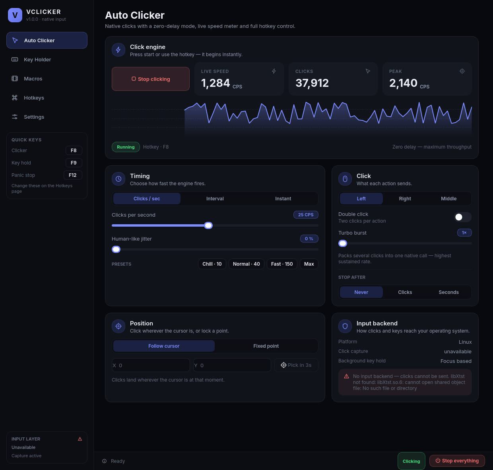
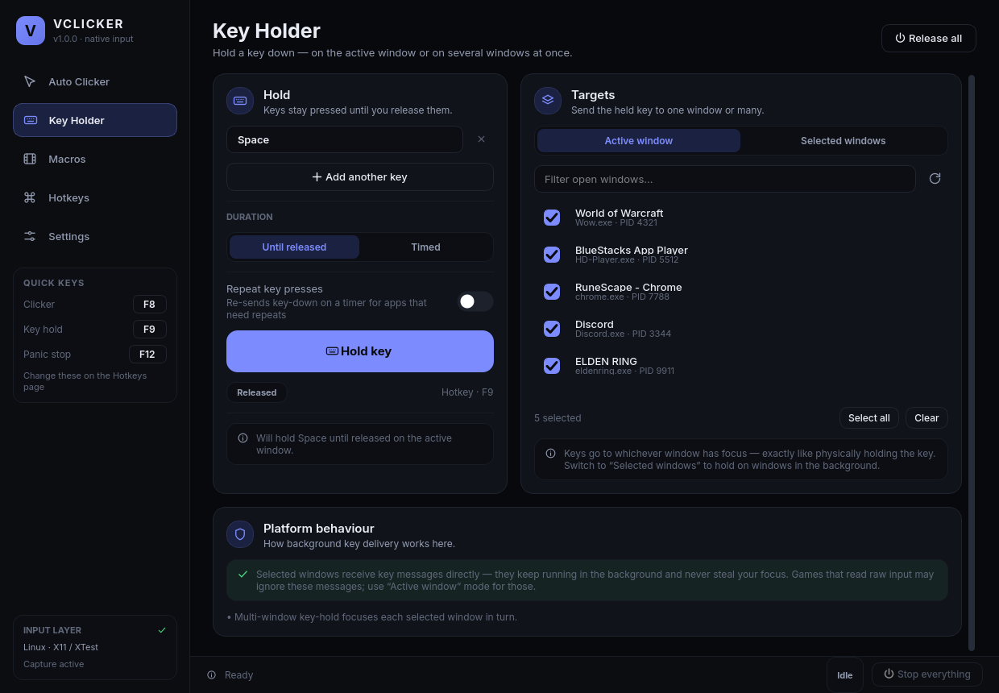
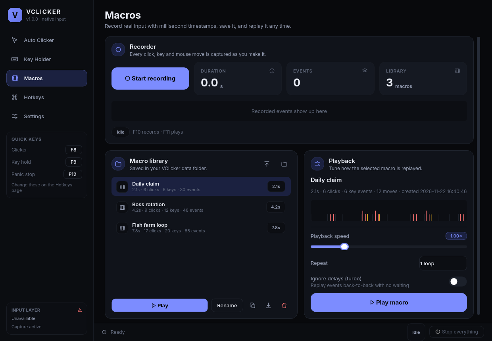
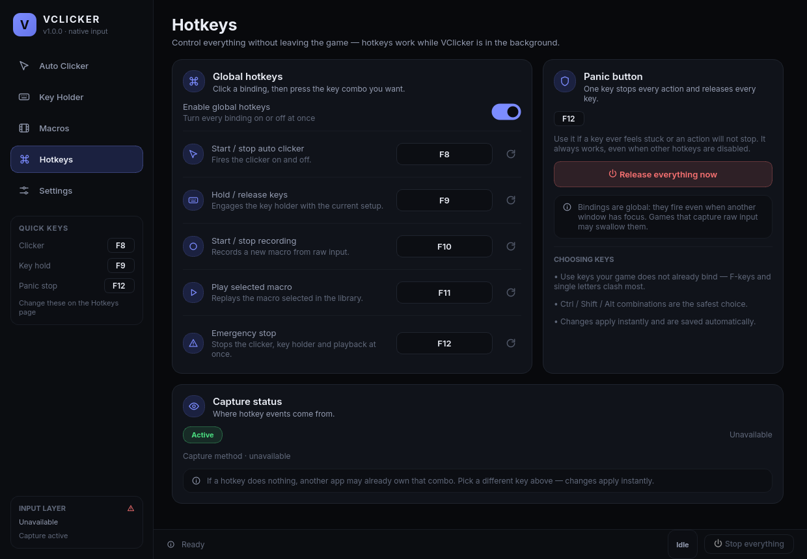
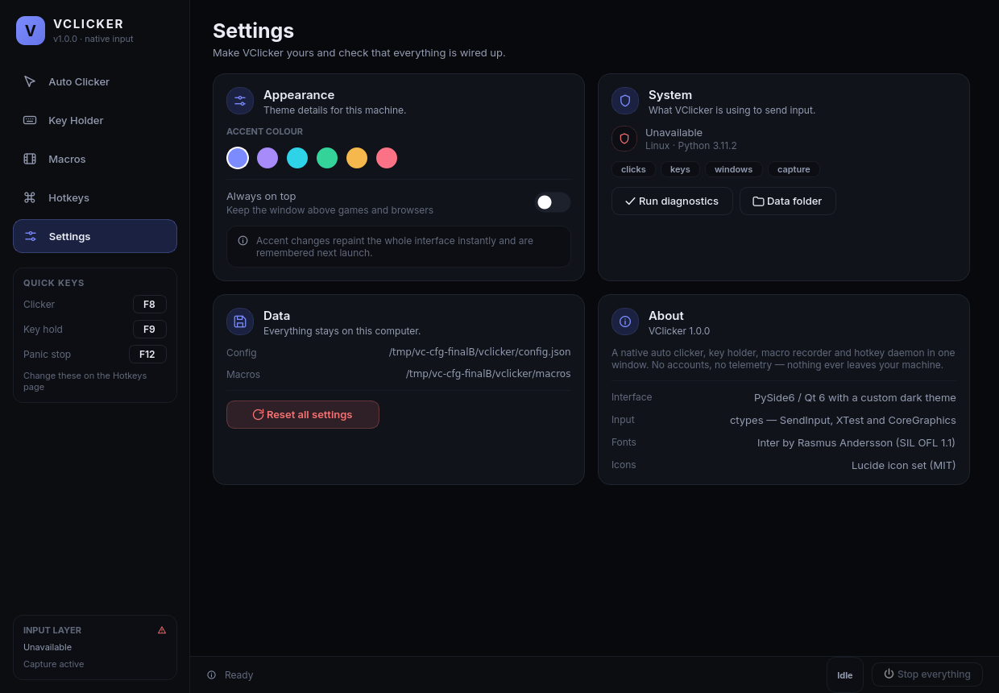
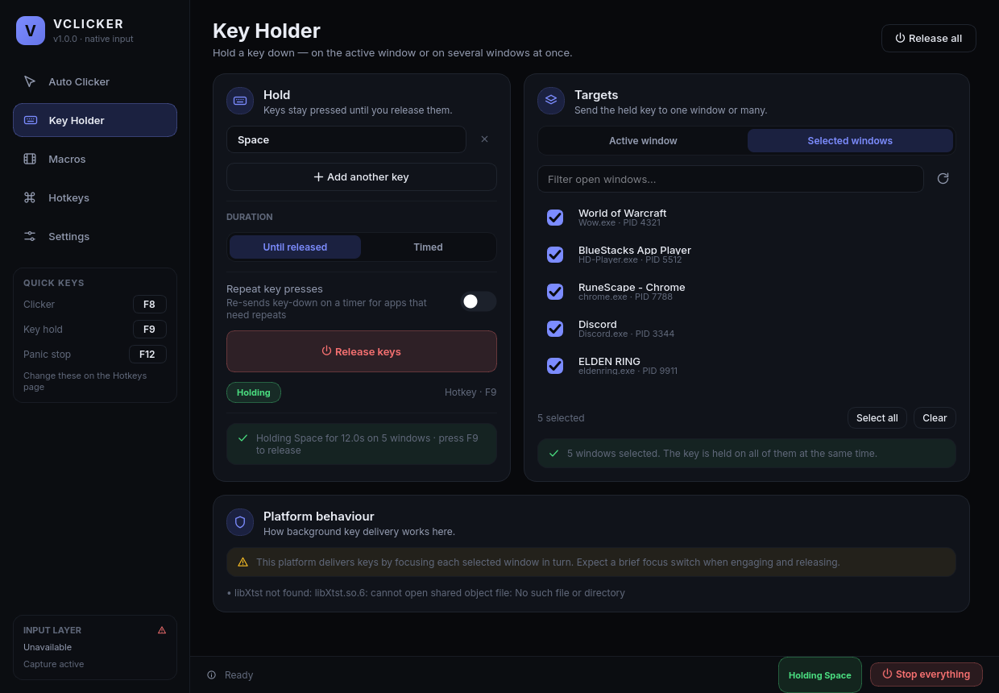

# VClicker

**An auto clicker with an "instant" mode, a multi-window key holder, global hotkeys and a macro recorder — in one native desktop app.**

VClicker talks straight to the operating system (`SendInput` on Windows, `XTest` on X11, `CoreGraphics` on macOS) through Python's `ctypes`, so there is no interpreter overhead between your click and the OS. The only third-party dependency is Qt 6 for the interface.



---

## Everything in the box

| | |
|---|---|
| **Instant auto clicker** | CPS mode (1 – 1000), millisecond interval mode, or **Instant** — no delay at all. Live CPS meter, peak tracking, click/time limits, fixed-point or follow-cursor, optional human jitter, and a **turbo burst** that packs several clicks into one native call. |
| **Multi-window key holder** | Hold one or more keys down on the active window, or tick several windows and hold the key on all of them at once. Optional timed auto-release and key-repeat for apps that need it. |
| **Global hotkeys** | Start/stop the clicker, hold/release keys, record, play and panic-stop from anywhere — even while the game has focus. Rebind any action to any combo, including `Ctrl`/`Shift`/`Alt` combinations. |
| **Macro recorder + library** | Records clicks, keys, wheel and mouse movement with precise timestamps. Save, rename, duplicate, export/import and replay with speed control (0.25× – 4×), looping and a "turbo" mode that ignores delays. |
| **Safety** | `F12` panic stop always works, releases every key and stops every action. Held keys are force-released if the app quits. |

---

## Screenshots

> Rendered from the real application (`tools/preview.py`), running on the sandbox's headless Qt.

| Auto clicker | Key holder |
|---|---|
|  |  |

| Macros | Hotkeys |
|---|---|
|  |  |

| Settings | Diagnostics |
|---|---|
|  |  |

Six accent colours re-theme the entire interface instantly:


---

## Quick start

### 1. Install Python 3.10 or newer

Windows: [python.org/downloads](https://www.python.org/downloads/) — tick **"Add python.exe to PATH"** during setup.

### 2. Install the one dependency

```bash
pip install PySide6-Essentials
```

or, from this folder:

```bash
pip install -r requirements.txt
```

### 3. Run it

```bash
python run.py
```

* **Windows:** `python run.py` or double-click **`run.pyw`** (no console window).
* **macOS / Linux:** `python3 run.py`.
* Installed as a package? Just run **`vclicker`**.

### 4. Build a single .exe (optional)

```bash
pip install pyinstaller
python tools/build_exe.py
```

The result is `dist/VClicker.exe` with the fonts, icons and Qt runtime embedded.

---

## The four tools

### Auto clicker

| Mode | What it does |
|---|---|
| **Clicks / sec** | Fires at a fixed rate (1 – 1000 CPS), with drift-free scheduling. |
| **Interval** | Fires every *N* milliseconds. |
| **Instant** | Zero delay: a tight native loop. Expect tens of thousands of clicks per second and one fully used CPU core. |

* **Turbo burst** packs 1–64 clicks into a single native input call — the highest sustained click rate the OS will accept.
* **Stop after** can be unlimited, a click count, or a duration.
* **Position** either follows the cursor or locks to a point you pick with a 3-second countdown.
* **Human-like jitter** randomises the delay if you want the timing to look less machine-perfect.
* Presets: *Chill · 10*, *Normal · 40*, *Fast · 150*, *Max* (instant).

### Key holder

1. Pick the key (or add up to four keys).
2. Choose **Until released** or **Timed** (auto-release after *N* seconds).
3. Choose **Active window** (send to whatever has focus) or **Selected windows**.
4. With *Selected windows*, tick as many open windows as you like — the key is held on all of them simultaneously, without stealing focus.



*Platform notes:* on Windows the keys are delivered with `PostMessage`, so target windows stay in the background. On X11 the selected windows are focused in turn (X11 has no safe background key delivery). DirectInput/Raw Input games ignore synthetic messages — use *Active window* for those.

### Macros

* Press **Record** (or `F10`), perform your clicks and keys, press it again — the macro is saved automatically to your macro library.
* Playback supports speed (0.25× – 4×), loops and **turbo** (ignore original delays).
* Import/export plain JSON files, so macros are easy to share or hand-edit.

Macro file format:

```json
{
  "format": "vclicker.macro",
  "version": 1,
  "name": "Boss rotation",
  "created": "2026-11-22T16:26:55",
  "duration": 4.2,
  "events": [
    {"t": 0.0,  "e": "move", "x": 812, "y": 430},
    {"t": 0.02, "e": "down", "b": "left", "x": 812, "y": 430},
    {"t": 0.06, "e": "up",   "b": "left"},
    {"t": 0.4,  "e": "key_down", "k": "1"},
    {"t": 0.45, "e": "key_up",   "k": "1"}
  ]
}
```

### Hotkeys

| Action | Default |
|---|---|
| Start / stop auto clicker | `F8` |
| Hold / release keys | `F9` |
| Start / stop recording | `F10` |
| Play selected macro | `F11` |
| Emergency stop | `F12` |

Click a binding on the **Hotkeys** page and press the combo you want — it applies instantly and is saved. The panic key works even when other hotkeys are disabled. Pressing `Esc` while the VClicker window is focused also stops everything.

---

## Data & settings

Everything is stored locally, in plain JSON:

| OS | Location |
|---|---|
| Windows | `%APPDATA%\VClicker\` |
| macOS | `~/Library/Application Support/VClicker/` |
| Linux | `~/.config/vclicker/` |

`config.json` holds your settings and hotkeys, `macros/` holds one JSON file per macro. No telemetry, no accounts, nothing leaves your machine.

---

## Notes, limits and honesty

* **Windows:** clicks use `SendInput`; capture uses low-level keyboard/mouse hooks (`WH_KEYBOARD_LL` / `WH_MOUSE_LL`). **Run VClicker as administrator** if the target game runs elevated, otherwise Windows blocks the input.
* **Some games ignore synthetic input.** Anything using Raw Input / DirectInput (many competitive shooters) or kernel anti-cheat will not see these clicks. That is an OS/driver boundary, not a bug. Never use automation in games that forbid it — you can lose your account.
* **Linux:** X11 is required; native Wayland sessions can only inject into XWayland windows. Mouse wheel is not captured while recording on X11. Global capture polls the X server every 2 ms, so timestamps are accurate to about 2 ms.
* **macOS:** input injection needs **Accessibility** permission (System Settings → Privacy & Security → Accessibility), and macOS support is experimental: no multi-window targeting.
* Heavy clicking can freeze or crash the app you are clicking on — start slow, and keep `F12` within reach.

---

## Development

```bash
python tools/selftest.py     # 28 engine checks: clicker timing, key holder, recorder,
                             # playback, macro storage, hotkey matching
python tools/uitest.py       # 20 UI checks driving the real window against a fake backend
python tools/preview.py out/ # renders every page to PNG (offscreen, no display needed)
```

For the screenshot/preview and UI test tools on a machine without a display, set `QT_QPA_PLATFORM=offscreen`.

### How it is put together

```
run.py / run.pyw            launcher (+ friendly "install PySide6" message)
vclicker/
  app.py                    QApplication bootstrap, font loading, theme
  config.py, paths.py       JSON settings + per-OS data folders
  theme.py, icons.py        design tokens, Qt stylesheet, inline SVG icons
  keys.py                   portable key table (Windows VK / X11 keysym / macOS code)
  context.py                shared engines + config + cross-page signals
  core/
    backend.py              picks the platform backend
    backend_win.py          SendInput, PostMessage targeting, low-level hooks
    backend_x11.py          XTest, window list, 2 ms polling capture
    backend_mac.py          CoreGraphics (experimental)
    monitor.py              global input capture base + dispatcher thread
    clicker.py              auto clicker engine
    keyholder.py            key hold engine
    recorder.py, player.py  macro capture and replay
    macros.py               macro model + JSON storage
    hotkeys.py              combo matching, capture, panic key
  ui/
    main_window.py          sidebar, page stack, live status strip
    widgets.py              cards, switches, segmented controls, sliders, graphs…
    pages/                  clicker, key holder, macros, hotkeys, settings
```

The interface only depends on Qt widgets + QSS: no images are used for layout, icons are inline SVG paths, and the bundled **Inter** font (SIL OFL 1.1) keeps typography identical on every OS.

---

## Credits

* Qt 6 / PySide6 — LGPLv3
* [Inter](https://github.com/rsms/inter) by Rasmus Andersson — SIL OFL 1.1 (bundled)
* [Lucide](https://lucide.dev) icon paths — MIT

Use VClicker responsibly: only where automation is allowed.
